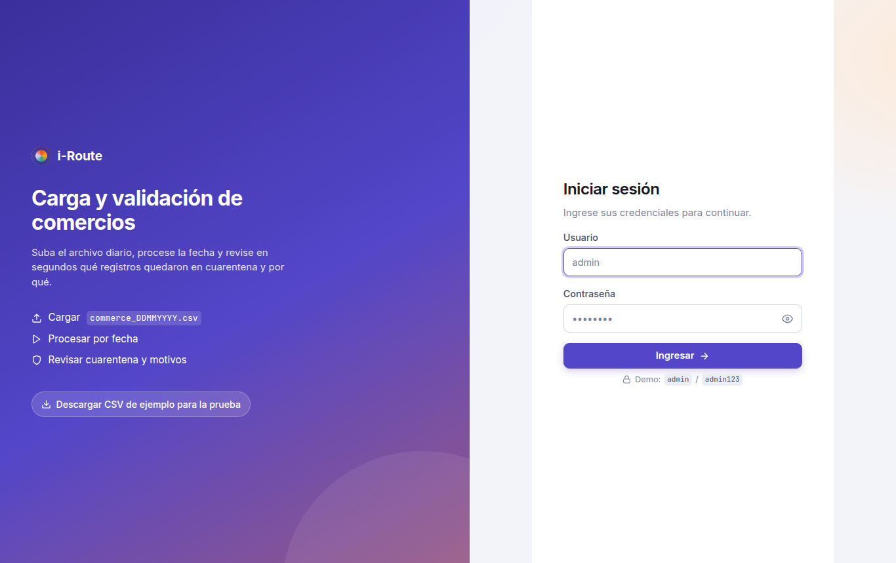
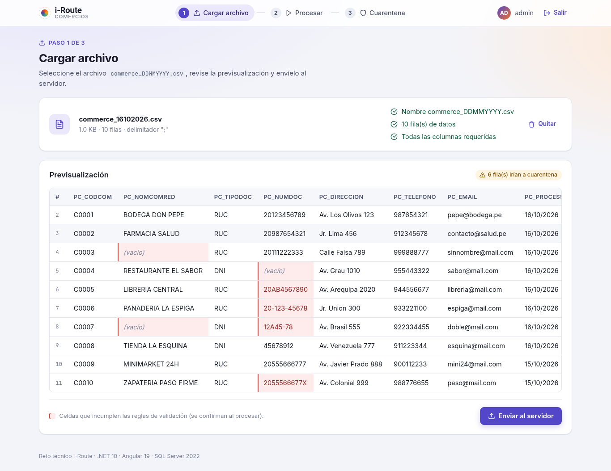
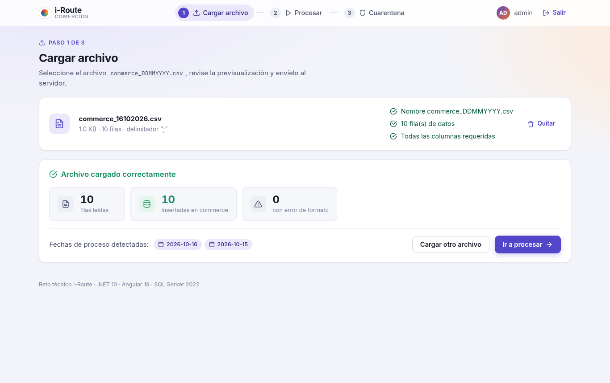
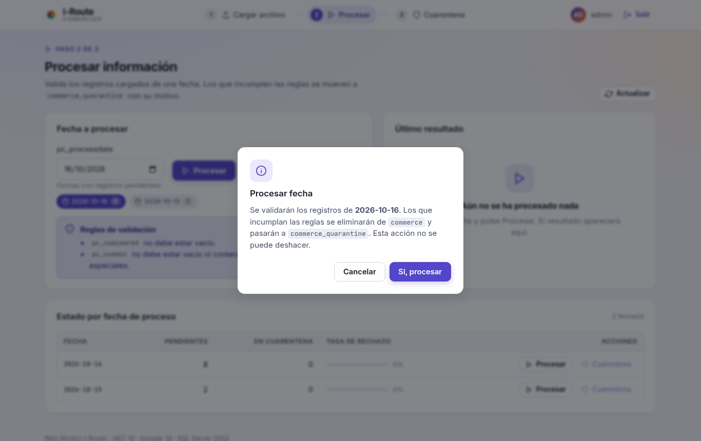
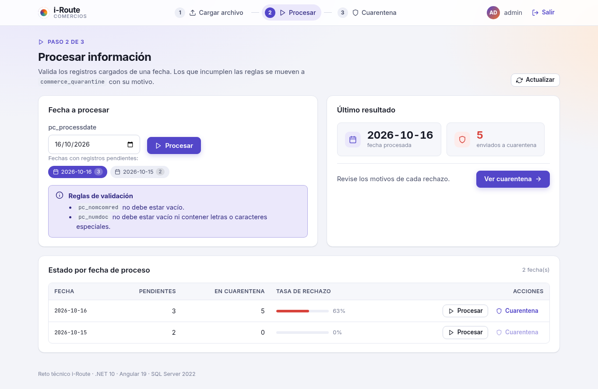
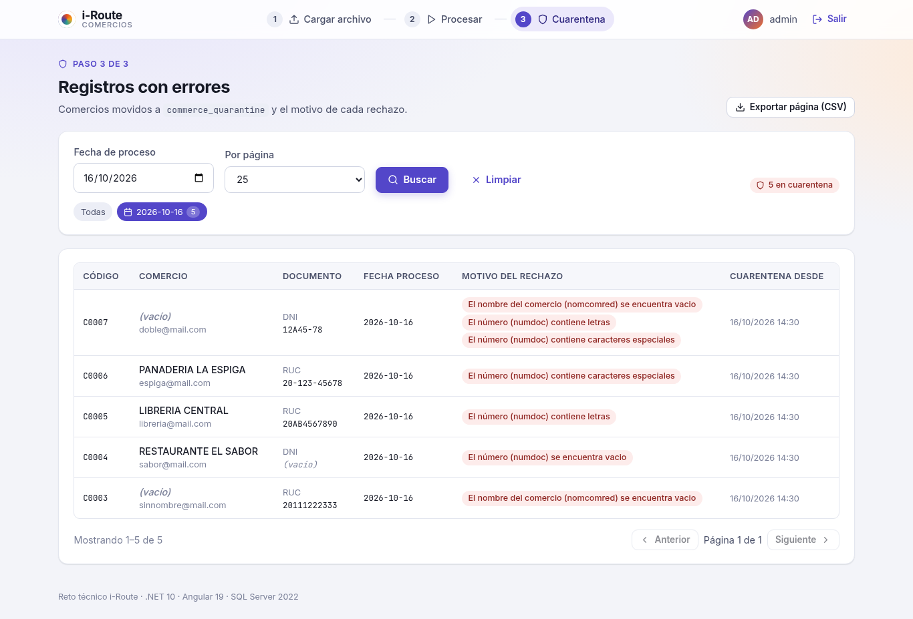
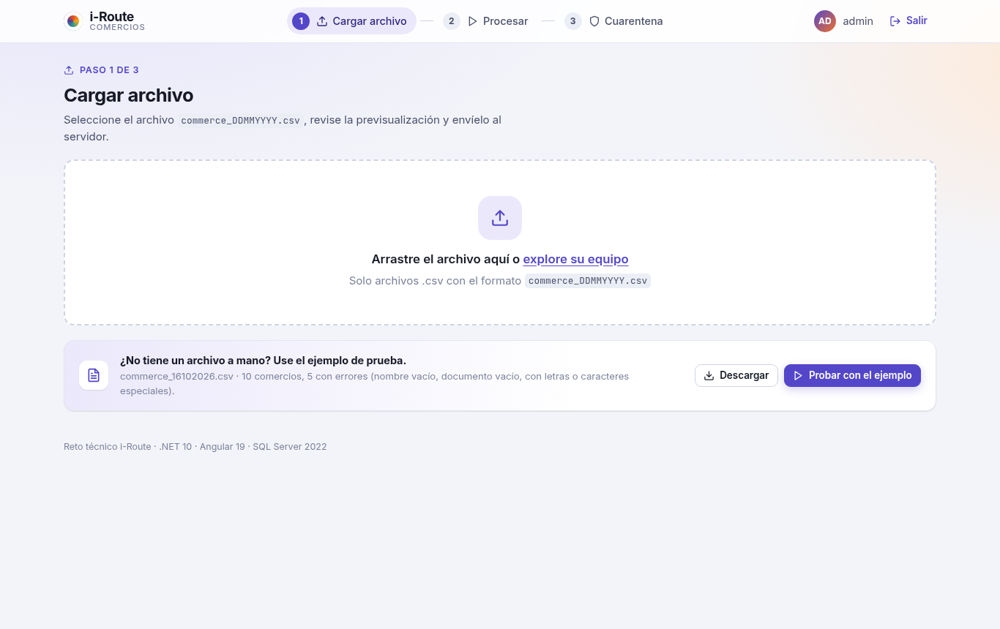
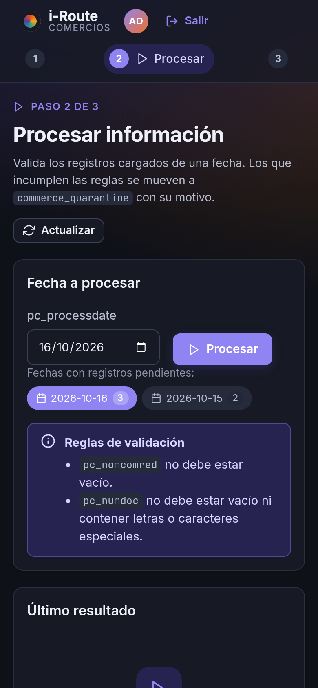
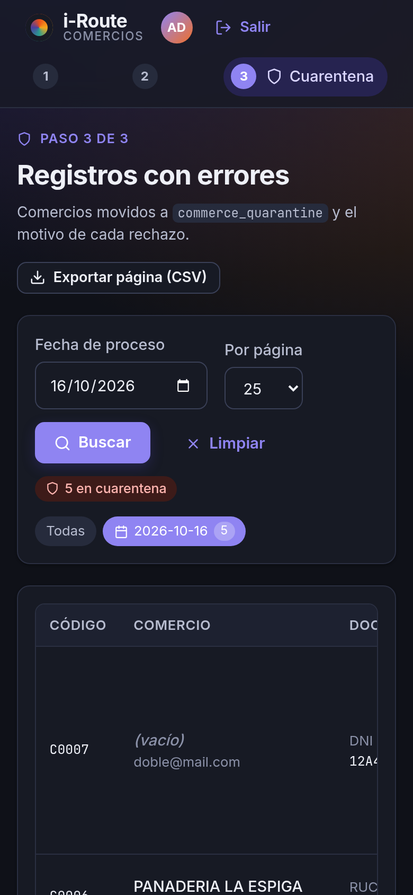

# i-Route · Reto técnico (Back .NET · Front Angular · SQL Server)

Aplicación web para cargar el archivo `commerce_DDMMYYYY.csv`, registrarlo en SQL Server mediante
stored procedures, validar los registros de una fecha de proceso y consultar los que quedaron en
cuarentena con su motivo.

```
iroute/
├── database/     Scripts SQL Server (tablas, TVP, stored procedures) + CSV de ejemplo
├── backend/      API REST .NET 10 (Clean Architecture ligera: Domain / Application / Infrastructure / Api)
├── frontend/     SPA Angular 19 (standalone components, signals, lazy routes)
└── docker-compose.yml  SQL Server 2022 local
```

## Capturas

| Inicio de sesión | Cargar archivo (previsualización con prevalidación) |
|---|---|
|  |  |

| Resultado de la carga | Procesar: confirmación |
|---|---|
|  |  |

| Procesar: resultado y estado por fecha | Cuarentena con motivos |
|---|---|
|  |  |

<details>
<summary>Pantalla de inicio sin archivo y vistas móviles en modo oscuro</summary>



| Procesar (móvil, oscuro) | Cuarentena (móvil, oscuro) |
|---|---|
|  |  |

</details>

## Requisitos

| Herramienta | Versión usada |
|---|---|
| .NET SDK | 10.0 |
| Node.js / npm | 24 / 11 |
| Angular CLI | 19 |
| SQL Server | 2022 (Docker) o instancia local |

## Puesta en marcha

### 1. Base de datos

```bash
docker compose up -d          # levanta SQL Server en localhost:1433 (sa / IRoute#2026Strong)
./database/apply.sh           # crea IRouteDb, tablas, tipo de tabla y stored procedures
```

Si ya tiene un SQL Server local, ejecute los scripts `database/0*.sql` en orden con SSMS o `sqlcmd`
y ajuste `ConnectionStrings:IRouteDb` en `backend/src/IRoute.Api/appsettings.json`.

### 2. Backend

```bash
cd backend
dotnet test                                     # 13 pruebas unitarias
dotnet run --project src/IRoute.Api             # http://localhost:5080  ·  Swagger: /swagger
```

### 3. Frontend

```bash
cd frontend
npm install
npm start                                       # http://localhost:4200 (y en la red local, ver abajo)
```

### 4. Acceso desde otros dispositivos de la red WiFi

El API escucha en todas las interfaces (`http://0.0.0.0:5080`) y el servidor de desarrollo de Angular
arranca con `--host 0.0.0.0` y un proxy (`frontend/proxy.conf.json`) que reenvía `/api` al backend.
Así, cualquier equipo o celular de la misma red usa **una sola URL** y no hay problemas de CORS:

```
http://<IP-de-esta-máquina>:4200        # ejemplo: http://192.168.0.125:4200
http://<IP-de-esta-máquina>:5080/swagger # Swagger del API (opcional)
```

Obtenga la IP con `hostname -I` (Linux) o `ipconfig` (Windows). Si otro dispositivo no conecta,
revise el firewall local (por ejemplo `sudo ufw allow 4200,5080/tcp`).

Credenciales de prueba (configurables en `appsettings.json`, sección `Auth`): **admin / admin123**.

## Flujo funcional

1. **Cargar archivo** (`/upload`): se selecciona o arrastra `commerce_DDMMYYYY.csv`. El navegador
   previsualiza las filas, detecta el delimitador (`;` o `,`) y avisa si faltan columnas o el nombre
   no cumple el patrón. Al enviar, el API inserta todas las filas con **un solo** `sp_create_commerce`.
2. **Procesar** (`/process`): se elige una fecha `pc_processdate` y se ejecuta `sp_process_commerce`.
   Los registros inválidos se mueven a `commerce_quarantine` y se muestra cuántos fueron.
3. **Cuarentena** (`/quarantine`): listado paginado con filtro por fecha y el **motivo** de cada
   rechazo (un registro puede acumular varios motivos).
4. **Login** (`/login`, opcional del reto): JWT emitido por el API y adjuntado por un interceptor.

Archivo de ejemplo: `database/sample/commerce_16102026.csv` (10 filas; 5 inválidas para la fecha 16/10/2026).
El mismo archivo se sirve desde el front (`frontend/public/samples/`): en la pantalla de inicio hay botones para
**descargarlo** o **cargarlo directamente** en la previsualización, y en el login un enlace de descarga.

## API REST

| Método | Ruta | Descripción |
|---|---|---|
| `POST` | `/api/auth/login` | Devuelve JWT. Body `{ "username", "password" }`. |
| `POST` | `/api/commerce/upload` | `multipart/form-data` con campo `file`. **400** si el archivo está vacío, el nombre no es `commerce_DDMMYYYY.csv` o faltan columnas. Invoca `sp_create_commerce`. |
| `POST` | `/api/commerce/process` | Body `{ "processDate": "yyyy-MM-dd" }`. Invoca `sp_process_commerce` y devuelve `quarantinedCount`. |
| `GET` | `/api/commerce/quarantine` | Lista `commerce_quarantine`. Query: `processDate`, `page`, `pageSize`. |
| `GET` | `/api/commerce/summary` | Pendientes / en cuarentena por fecha (apoyo para la pantalla Procesar). |
| `GET` | `/health` | Health check. |

Los errores siguen RFC 7807 (`ProblemDetails`). Todos los endpoints de `commerce` requieren `Authorization: Bearer <token>`.

### Estructura del CSV

```
pc_codcom;pc_nomcomred;pc_tipodoc;pc_numdoc;pc_direccion;pc_telefono;pc_email;pc_processdate
```

`pc_processdate` acepta `dd/MM/yyyy`, `ddMMyyyy`, `yyyy-MM-dd`, `dd-MM-yyyy` o `yyyyMMdd`.
La tabla `commerce` replica estas columnas (más `id` y `created_at`).

## Reglas de validación (`sp_process_commerce`)

| Regla | Motivo registrado |
|---|---|
| `pc_nomcomred` vacío | `El nombre del comercio (nomcomred) se encuentra vacio` |
| `pc_numdoc` vacío | `El número (numdoc) se encuentra vacio` |
| `pc_numdoc` con letras | `El número (numdoc) contiene letras` |
| `pc_numdoc` con caracteres especiales | `El número (numdoc) contiene caracteres especiales` |

Los motivos se concatenan con `; ` cuando un registro incumple más de una regla.
El movimiento se hace con un único `DELETE … OUTPUT … INTO` dentro de una transacción (atómico, sin cursores).

## Decisiones de diseño

- **Capas**: `Domain` (entidades) → `Application` (casos de uso, contratos) → `Infrastructure`
  (Dapper + CsvHelper) → `Api` (controladores, auth, manejo de errores). Las dependencias apuntan hacia adentro.
- **Eficiencia**: carga masiva por *Table-Valued Parameter* (un round-trip por archivo), lectura del CSV en
  streaming, índices por `pc_processdate`, paginación con `OFFSET/FETCH`, conexiones abiertas solo durante la llamada.
- **Errores de formato por fila** (fecha inválida) no abortan la carga: se devuelven al cliente y las filas válidas sí se insertan.
- **Front**: componentes standalone con `signals`, rutas *lazy*, interceptores para JWT y errores,
  previsualización local del CSV con prevalidación de filas (replica las reglas del SP para anticipar rechazos),
  diálogo de confirmación antes de procesar, estados vacíos y skeletons, exportación CSV de la cuarentena,
  modo claro/oscuro automático y diseño responsive, sin librerías de UI externas (bundle inicial ≈ 87 kB gzip).
- **Seguridad**: JWT con clave simétrica, comparación de credenciales en tiempo constante, CORS restringido al origen del front, detalles internos no expuestos al cliente.

## Pruebas

```bash
cd backend  && dotnet test          # parser CSV y servicio de aplicación (xUnit + NSubstitute)
cd frontend && npm test             # utilidades de previsualización (Karma/Jasmine, requiere Chrome)
```
